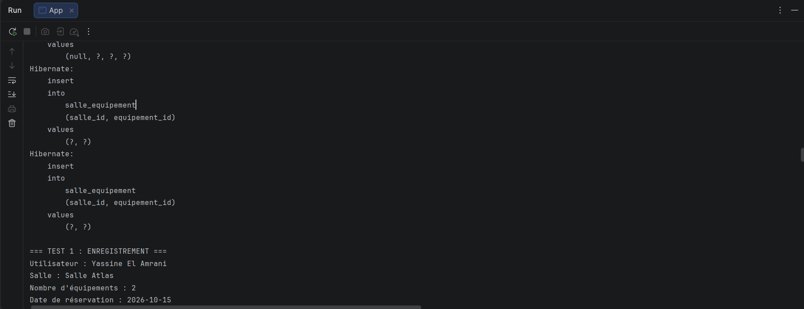
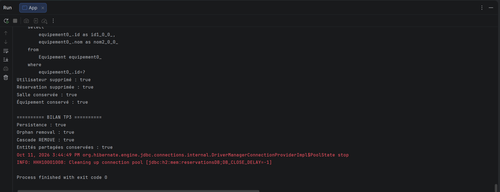

# TP3 — Gestion des relations JPA avec Hibernate

## Présentation

Ce TP consiste à développer une application Java de gestion des réservations de salles avec JPA, Hibernate et H2. L'objectif est de mettre en pratique les relations entre entités, les cascades et la suppression orpheline.

## Technologies utilisées

- Java / Maven
- JPA 2.2
- Hibernate 5.4.30.Final
- H2 Database 1.4.200

## Fonctionnalités

- Gestion des entités Utilisateur, Salle, Reservation et Equipement.
- Relations OneToMany, ManyToOne et ManyToMany.
- Gestion des cascades avec CascadeType.
- Suppression orpheline avec orphanRemoval.
- Tests de persistance et de suppression avec EntityManager.

## Exécution

1. Ouvrir le projet Maven dans IntelliJ IDEA.
2. Compiler le projet :

```bash
mvn clean compile
```

3. Exécuter la classe `com.example.App`.

## Preuves d'exécution

### 1. Persistance des entités avec Hibernate

Cette capture montre l'enregistrement des associations entre les salles et les équipements.



### 2. Résultats des tests JPA

Cette capture présente les résultats des tests de persistance, de suppression orpheline et de suppression en cascade.



Tous les tests ont été exécutés avec succès.

## Conclusion

Ce TP a permis de mettre en pratique les relations JPA avec Hibernate, la gestion des cascades et la suppression orpheline, tout en assurant l'intégrité des données.
